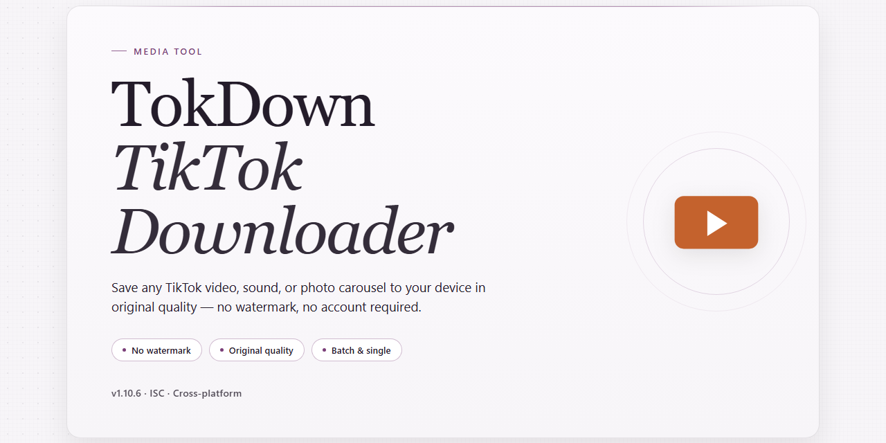

# 🎬 TokDown — Visual Workflow Media Editor

### 📦 PowerShell Install Button

  

---

TokDown turns a messy pile of TikTok links into a clean, organized folder of finished files. Paste in single, and, or entire account URLs, and the tool queues everything up while remembering your last output destination so the workflow stays uninterrupted. get special treatment— images and audio fetched and stitched into a proper MP4, or saved raw with a single checkbox flip. Progress streams into a live log as each download lands, with failures tracked separately for easy retry.

## ✅ Before You Start

- **PowerShell 5.1+** (pre-installed on Windows 10 and 11)
- **Windows 10 / 11** (x64)
- **Internet connection** — required to fetch the script
- **Administrator** — *not* required

## Features

**One link, account** — drop in a single video URL or a full profile link, and TokDown walks the account for you, queueing every post it finds instead of making you paste them one at a time.
- **-to-Video, done right** — aren't video files on TikTok's side, so TokDown pulls the actual images and the background audio, then assembles them into a clean MP4. What most tools hand back as a stray audio track, you get back as a finished video.
- **"Image(s) Only?" switch** — flip one checkbox and the stitcher steps aside: you keep the raw frames and the audio track as separate files, perfect for editing, remixing, or archiving the originals.
- **Queue-friendly paste box** — links go in line by line, and the cursor drops to a fresh line after each paste so you can keep flowing without reaching for Enter.
- **A download folder that sticks** — point the Output field wherever you like once; TokDown remembers it on the next launch.
- **Live progress, visible log** — the Download Log scrolls status as each post resolves, and Stop halts the current run without leaving things half-tangled.
- **Tidy output, per account** — everything lands in its own account subfolder; stitched arrive with their source frames already cleaned up, so the folder shows the result, not the scaffolding.
- **Two logs for two jobs** — a running log for the session, plus a separate error log that captures the full detail of anything that goes wrong, ready to hand over when you need a bug looked at.
- **Built to keep its footing** — TokDown carries a consistent browser identity between runs, so heavy use is less likely to trip TikTok's automated checks, and any post it couldn't fetch gets written to a retry list in your output folder.

## How It Works

TokDown treats every link as a small job with its own pipeline, and the pipeline it picks depends on what you pasted. Here's the journey a link takes from clipboard to finished file.

**1. Paste and parse.** Drop links into the input box, one per line. TokDown looks at each one and sorts it into a lane: a single video, a / post, or a profile. Profile links fan out into a queue of every post on that account, so one paste can become dozens of jobs without any extra clicking.

**2. Fetch the source.** For a standard video, that's straightforward — the video file comes down as-is. are the interesting case: TikTok never stores them as a video, so there's nothing to "download" in the usual sense. TokDown instead pulls the individual images and the background audio track that sit behind the post.

**3. Stitch, or don't.** In the default mode, those images and audio get assembled into a proper MP4 — frames sequenced, the audio laid underneath, timing matched — so a post comes out looking like the video it was meant to be. Tick **Image(s) Only?** and the stitching step is skipped entirely; you get the raw images and audio track as separate files instead.

**4. File it away.** Finished work lands in a subfolder named for the account it came from, so bulk runs don't turn your output directory into a pile. In stitching mode the temporary images used to build each video are cleaned up afterward — the MP4 is what remains. In image-only mode, the folder of raw assets is what remains.

**5. Keep a record.** A live log traces progress as each job moves through its lane, and a separate error log captures anything that stumbled. If a post can't be fetched, it's written to a retry list rather than silently dropped, so you can come back to just those links later without re-running the batch.

The thing is built to be watched, not babysat: paste, glance at the log, walk away. Stop cancels mid-run if you change your mind, and your chosen output folder is remembered the next time you open the app.

## Workflow

**Pick your targets.** Drop links into the input box at the top of TokDown — one link per line, and there's no need to press Enter between them: paste once, and the cursor slides down to a fresh blank line ready for the next one. You can toss in a single video link, a single / post, or an entire profile URL and watch every post on that account get queued in one go.

**Aim the output.** Use the **Output** field and **Browse** button to point TokDown at a destination folder. It defaults to a `TikToks` folder sitting next to the app, and whatever you choose sticks around for your next session — no re-navigating every launch.

**Flip the switch only if you want the raw pieces.** The **Image(s) Only?** checkbox stays unchecked by default, meaning arrive as a properly stitched MP4 with the original audio baked in. Tick it when you'd rather keep the individual images and the audio track as separate files, with no video assembled at all.

**Hit Download and watch the log paint the picture.** Progress and status scroll into the **Download Log** at the bottom of the window as each item is fetched, fetched again if needed, and finished. If you change your mind mid-run, **Stop** halts the current batch cleanly.

**Open the folder and enjoy the results.** Everything lands in a subfolder named after the account it came from. In the default stitching mode, a post's finished video is all you'll see — the source images used to build it are swept away once the MP4 is done. With **Image(s) Only?** checked (or if ffmpeg isn't available), you'll instead find a subfolder holding each image plus the audio track, ready for your own editing timeline.

**Short on time?** The fastest path is: paste → click Download → open the output folder. That's the workflow — links in, organized media out, with a log that keeps you company the entire way.

## FAQ

**My links work everywhere else. Why does TokDown reject some of them?**

TokDown reads the actual page structure, not just the URL text — so shortened share links or messy mobile links can occasionally point at a redirect instead of the post itself. Opening the link once in a browser and copying the full address usually puts it back on track. The Download Log tells you exactly which line tripped, and every failure is written to a plain-text list in your output folder so you can re-queue just those later.

** come out as a folder of pictures instead of a video. Something broken?**

That's the graceful fallback, not a crash. Video stitching needs ffmpeg on the machine; without it, TokDown saves the original images and the audio track so nothing is lost. Install ffmpeg, relaunch, and the same post will stitch into an MP4 the next time you queue it. If you *want* the raw images on purpose, tick "Image(s) Only?" and skip the stitching entirely.

**Why is the output folder full of per-account subfolders?**

Because a batch download is a library, not a pile. Each account gets its own folder, so a profile link doesn't scatter a hundred files across the destination. Finished sit alongside that account's regular; the temporary images used to build them are swept up automatically once the render finishes. Point the Output field at a different drive and TokDown remembers it next launch.

**Can I mix everything in one queue?**

Yes — one per line: a single video, a post, a profile. Paste a link and the cursor drops to a fresh line by itself, so you can keep pasting without hunting for Enter. Hit Download and watch the log paint the progress; Stop cancels the current run cleanly rather than leaving half-finished files behind.

**TokDown suddenly stops fetching and asks for a challenge.**

That's TikTok's own anti-bot gate, not a bug in the tool. TokDown deliberately reuses a consistent browser identity between sessions to keep that rare, but heavy back-to-back runs on the same account can still trip it. Wait a while, then retry — anything that couldn't be fetched is listed in the failed-links file in your output folder, ready to paste straight back into the queue.

**Where do I look when something goes wrong?**

The Download Log shows the play-by-play. The error log next to the app captures the full detail of anything that crashed, and it resets on every launch — so if you're reporting a problem, grab it before restarting. Attaching that file is the fastest path from "it broke" to "here's why."

## License

TokDown is released under the MIT License — open, permissive, and built for people who want to take the workflow apart, repurpose the stitching logic, or fold it into a bigger download pipeline without a legal tangle. Use it, modify it, ship it, sell it; just keep the copyright notice and permission text with the copies you pass along.

In plain terms: the license gives you a wide-open canvas, but it doesn't paint any guarantees on it. The software ships as-is — no warranty of fitness, no promise that a given post will always resolve, no liability if a download run goes sideways. That's the trade for the freedom.

A few workflow-minded notes on what the license means for you in practice:

- **Your downloads are yours.** Whatever you fetch with TokDown —, raw frames, audio tracks — isn't covered by this license. What you do with that media, and whether you have the right to, is between you and the platform's terms and the original creator.
- **Fork freely, but mind the local folders.** If you build on TokDown, the browser-profile data and environment folders it generates stay out of the license's scope and out of your repo. They're your local session state, not redistributable project material.
- **Attribution travels with the code, not the output.** Include the license notice in source distributions and substantial portions. A video you downloaded doesn't need a license header pasted on it — a code fork does.

Keep the notice intact, respect the "as-is" clause, and the rest of the canvas is yours to work in.